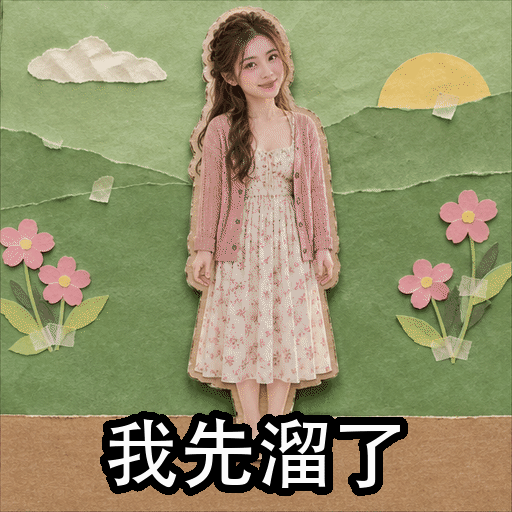
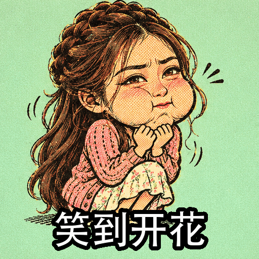
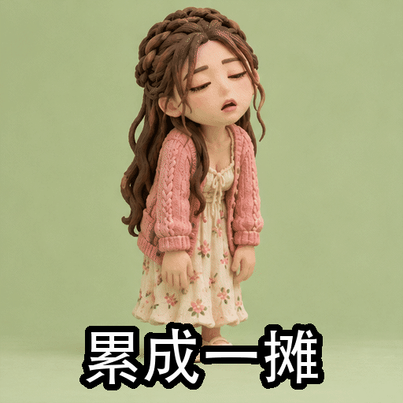
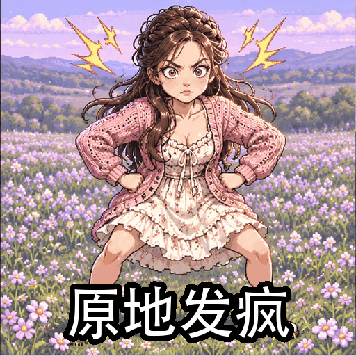
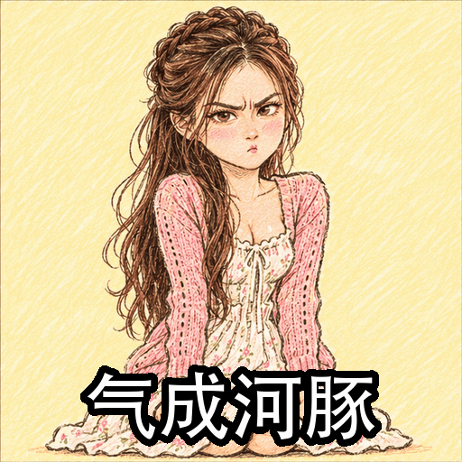
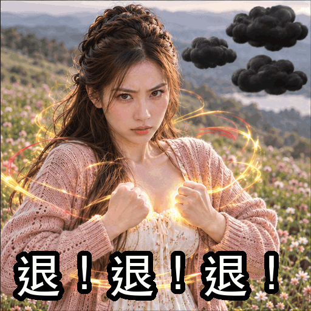
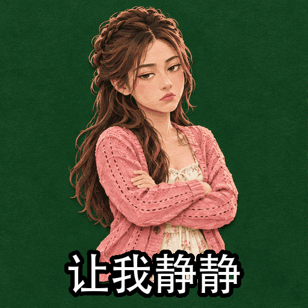
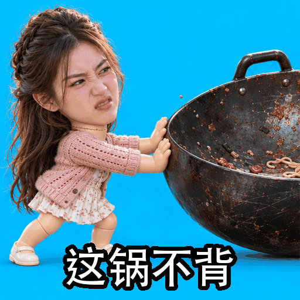

<div align="center">

# GIF Action Skills

**Turn one sentence into a set of Chinese reaction GIFs worth sending.**

<p>
  <a href="https://github.com/BTCUP99/gif-action-skills/actions/workflows/ci.yml"></a>
  <a href="https://github.com/BTCUP99/gif-action-skills/releases"></a>
  <a href="LICENSE"></a>
  
  
</p>

[中文](README.md) · [Catalog](CATALOG.md) · [Changelog](CHANGELOG.md)

</div>

> [!NOTE]
> **One attempt per idea.** Results vary. Each idea gets one generation attempt and one automatic playback check, then successful GIFs are delivered together with a list of any missing results. The creative catalog has not been exhaustively rendered or validated.

This skill turns a conversational attitude into an action, a gag, and a playable GIF. **If you do not give a quantity, it asks whether you want 6 or 9, then makes them all in one go, one generation per idea.** Ask for one, three, or twelve and you get that number; edits touch only the GIFs you name.

> "破防了，来一张。" (*"I just lost it. Make me a sticker."*)
> "Use my rice-ball character. My boss is promising the moon again. Make it absurd."
> "Here's a photo of my cat. Make a 12-piece sticker pack."

## One portrait, nine takes

| Slipping away | Laughing into bloom | Melted |
| --- | --- | --- |
|  |  |  |
| Spinning out | Pufferfish | Back off! |
|  |  |  |
| Leave me alone | No big deal | Not my fault |
|  |  |  |

Nine takes from one AI-generated portrait (not a real person), made by Codex with this skill. See the [Chinese README](README.md) for more samples.

## What's inside

| Item | Count | Notes |
| --- | ---: | --- |
| [Action cards](CATALOG.md) | 430 | Three-beat storyboard, loop type, gag mechanic, intensity, audience, motion type, and an optional natural-action marker |
| Scene categories | 38 | Everyday replies, work progress, comfort, moods, meltdowns, food, festivals, gaming, pets, kinetic text, photo-real gags, and more |
| [Visual styles](CATALOG.md#风格库) | See catalog | Doodle, pixel, clay, photo cutouts, ugly-cute, mixed media, and more |
| [Motion templates](CATALOG.md#动作模板) | See catalog | Reusable pose and timing structures with replaceable characters, props, attitudes, and styles |
| Sticker packs | 16 | Candidate action collections; the requested quantity controls delivery |
| Trend layer | 28 | Slang mapped to actions, dated so it can be updated |
| Tools | 6 | Action search and briefs, sheet assembly and light motion, GIF checks, Chinese captions, sheet splitting, encoding |

The catalog and its aliases are in Chinese, and the skill is written for Chinese chat culture. Most cards are original creative proposals and make no claim about popularity.

## How requests are interpreted

A new batch can use any combination of three structures:

| Structure | Example |
| --- | --- |
| One phrase, many performances | “I'm fine” as forced composure, melting, or a deadpan reaction |
| One subject, many reactions | A scarf-wearing cat welcoming, refusing, watching drama, or falling apart |
| One situation, many uses | Meeting replies for acknowledgment, progress, blame, or dismissal |

| Input | How it is used |
| --- | --- |
| Text with no subject | Different people, pets, or objects may perform the ideas |
| Text describing a subject | Keep the described features; an explicit consistent-character request applies across the batch |
| One image | Preserve recognizable subject features without automatically requiring photography |
| Image and text | The image identifies the subject; the text sets intent and constraints |
| Multiple images | Use clear roles and relationships as needed; ask only about consequential ambiguity |
| Existing GIFs | Caption and speed changes affect only the requested files, using local processing first. Clean source frames allow caption replacement without generation. “Another batch” or “nine new actions” starts a new creation |

“Discuss first” or “wait for confirmation” pauses generation. Once creation is requested, “use your judgment” allows production without an extra selection gate; brainstorming freely during a discussion still means proposals only. See [request interpretation](skills/gif-actions/references/requests.md).

## What a new creation delivers

- Six or nine independent animated GIFs, chosen before work starts, or the quantity you explicitly request. Ideas can differ in action, attitude, gag, props, and style; subject and style consistency follow the request.
- A combined preview and the individual files. A nine-tile gallery means nine finished GIFs, not nine animation frames or static candidates. The preview can display the original GIFs directly without rendering another large animation.
- One generation attempt per idea. There is no preliminary anchor sheet, first-three approval gate, automatic regeneration, or repeated visual repair loop. One automatic encoding/playback check is enough. Failed items are reported while the others continue; further generation happens only when you request it.

## Reference photos and templates

A reference photo preserves recognizable features and silhouette. It does not lock the output to photography: big heads, cartoon styles, exaggerated laughter, crying, facial acting, and deformation are allowed. Supply the original image in every generation call rather than replacing it with a written description. An explicit request for a realistic or photographic result locks the medium, while still allowing expressive performance.

Motion templates reuse a pose and timing structure. Replace the character, prop, style, and intensity to create different ideas. The default batch of nine is not a fixed list of nine templates.

Each resource has a role: action cards supply conversational meaning, templates supply poses, the comedy guide turns tone into a gag, styles define the visual treatment, and scene packs suggest useful replies. Combine what the request needs.

## Install

This skill targets Codex. On macOS or Linux:

```sh
git clone https://github.com/BTCUP99/gif-action-skills.git
cd gif-action-skills
python -m pip install -r skills/gif-actions/requirements.txt
mkdir -p ~/.agents/skills
ln -s "$PWD/skills/gif-actions" ~/.agents/skills/gif-actions
```

Then ask Codex: **"Use $gif-actions to make a set of stickers about hiding a phone as a coworker walks by."** It asks whether you want 6 or 9 first. Attach a reference image if you have one.

The tools need Python 3.9+ and Pillow. Run `git pull --ff-only` in this folder to update; new Codex sessions pick it up. You can also download a zip from [Releases](https://github.com/BTCUP99/gif-action-skills/releases) and unpack it into `~/.agents/skills/`.

## How GIFs are produced

Just say what you want. Codex uses whatever it currently has, with no setup and no third-party plugins: it generates a GIF directly if its tools can, and otherwise draws a sprite sheet and assembles the GIF locally. Each idea is generated once. Rough edges are part of the joke; tell it which one to change if you want another take.

## Manual use

From `skills/gif-actions`:

```sh
python scripts/action.py "画大饼" --brief --style doodle-meme --intensity absurd
python scripts/action.py "下班" --brief --character "an orange cat wearing sunglasses"
python scripts/action.py --list-templates
python scripts/action.py --template snap-freeze --character "a rice ball in a red scarf"
python scripts/action.py --pack worker-16 --character "a rice ball in a red scarf"
python scripts/action.py "我没事" --brief --photo-ref --style doodle-meme
python scripts/caption_gif.py out.gif "我真的会谢" captioned.gif --from-ms 600
python scripts/inspect_gif.py captioned.gif --json                                  # Optional troubleshooting
```

The optional `--photo-ok` filter selects actions that can use natural body proportions. It is not a requirement for using a person's reference image and does not lock the visual style. Contact sheets, reference comparisons, and light-motion tools remain available for manual use; they are not a default visual repair loop.

## Contributing

See [CONTRIBUTING.md](CONTRIBUTING.md). Licensed under [MIT](LICENSE). Only use reference images you have the right to use.
