<div align="center">

# Gagcha 笑抽

**一句话或一张图，抽出一组能拿去回消息的中文搞怪 GIF。**

<sub>Gag（笑点）+ Gacha（抽卡）</sub>

<p>
  <a href="https://github.com/BTCUP99/gagcha/actions/workflows/ci.yml"></a>
  <a href="https://github.com/BTCUP99/gagcha/releases"></a>
  <a href="LICENSE"></a>
  
  
</p>

[快速开始](#快速开始) · [动作图鉴](CATALOG.md) · [怎样出片](#怎样出片) · [路线图](#路线图) · [更新记录](CHANGELOG.md) · [English](README.en.md)

</div>

这个 Codex 技能把聊天语气变成动作：选一个能回消息的意思，配上夸张、反差或荒诞的玩法，生成可播放的 GIF。**没说数量时，它会先问你做 6 款还是 9 款，然后一次做完，每款生成一次，交给你挑。** 你明确说“一张”“三张”或“12 张”，就按你要的数量做；修改已有成品时，只处理你指定的那几款。

> [!NOTE]
> **创作抽卡。** 每个玩法只生成一次，不承诺每款都命中笑点。完成一次自动播放检查后，交付成功的独立 GIF 和集中预览，并列出失败项。动作卡与模板是创作提案，尚未全部出片验证。遇到问题欢迎[提交反馈](https://github.com/BTCUP99/gagcha/issues/new/choose)。

> “破防了，来一张。”
> “老板又画大饼，用我的饭团角色，抽象一点。”（先问 6 款还是 9 款）
> “用这张自拍做表情，大头、丑萌、抠图都可以。”
> “用我家猫的照片，做一套 12 张的猫猫表情包。”

### 一张写真，九种玩法

| 我先溜了 | 笑到开花 | 累成一摊 |
| --- | --- | --- |
| 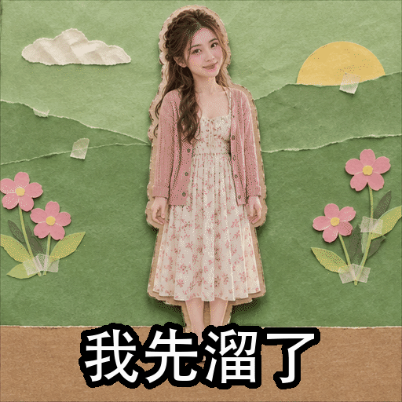 | 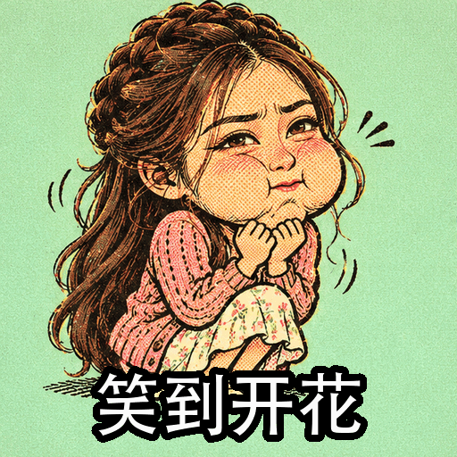 | 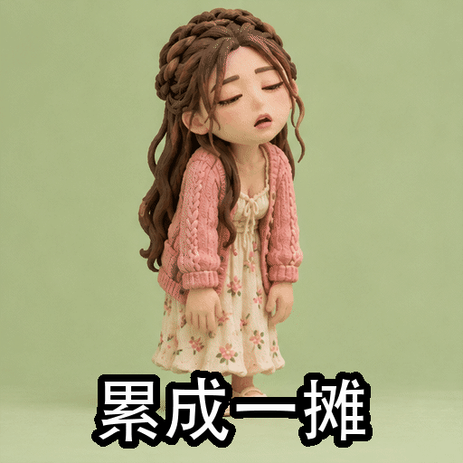 |
| **原地发疯** | **气成河豚** | **退！退！退！** |
| 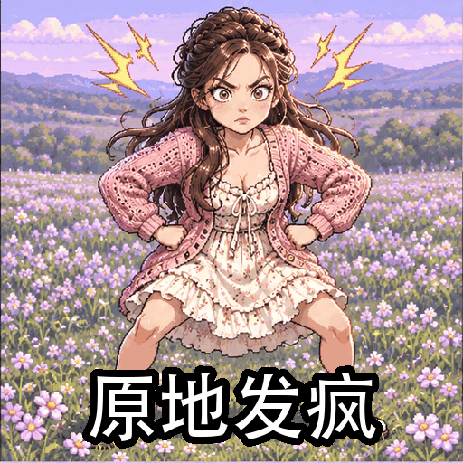 | 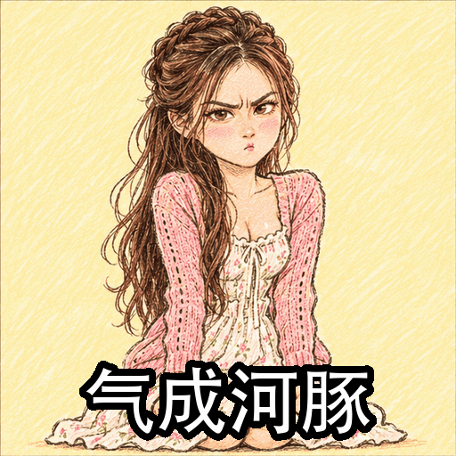 | 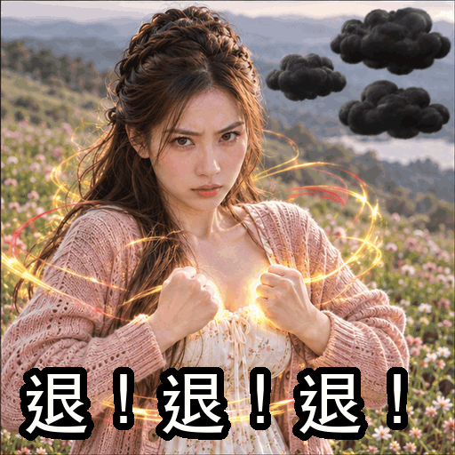 |
| **让我静静** | **问题不大** | **这锅不背** |
| 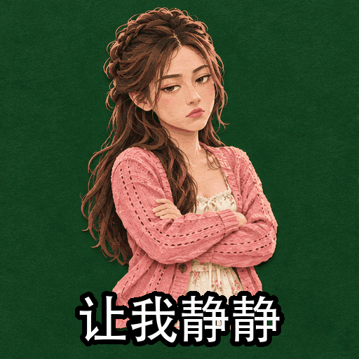 |  | 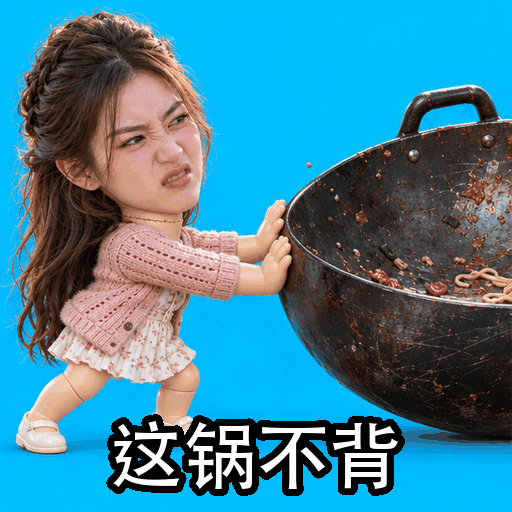 |

同一张 AI 生成的写真（非真人），由 Codex 使用本技能一次做出的九款，人物还认得出来，演法和画风各不相同。

### 换一张图，换一组玩法

| 收到！ | 开心到起飞 | 我先溜了 |
| --- | --- | --- |
|  |  |  |
| **有点离谱** | **不想动了** | **香迷糊了** |
|  | 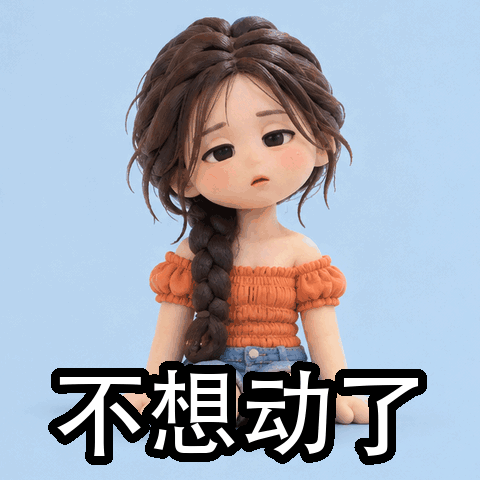 |  |

同一张 AI 生成的写真（非真人），由 Codex 使用本技能做出的六款。

### 没有参考图也能做

| 裂开了 | 累扁了 | 好耶！ |
| --- | --- | --- |
| 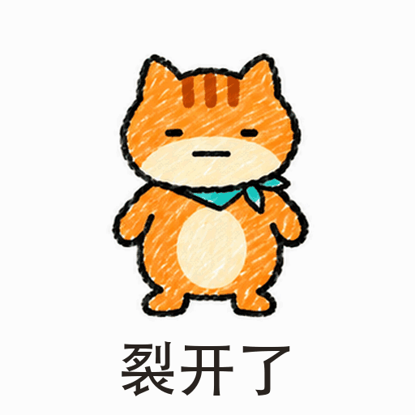 | 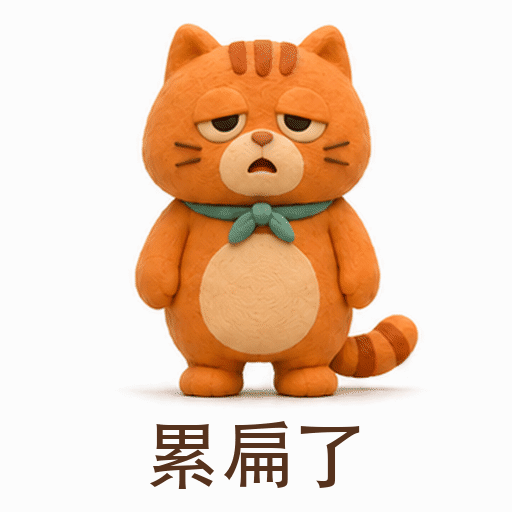 | 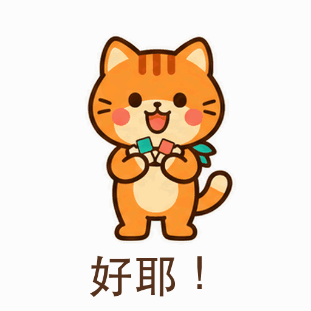 |
| **什么？！** | **充会电** | **下班！** |
| 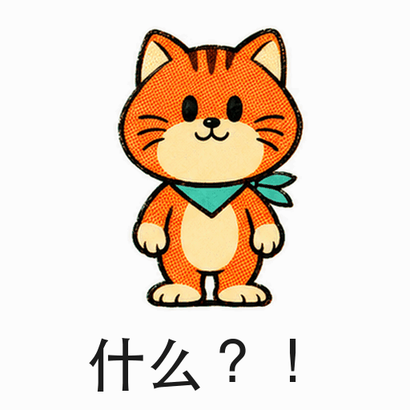 | 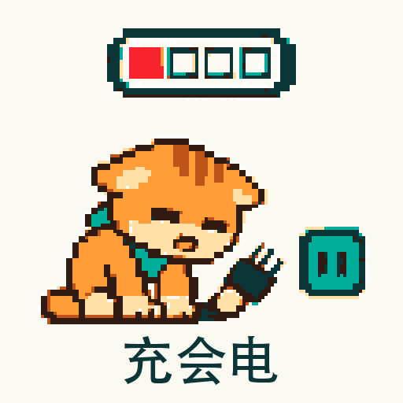 | 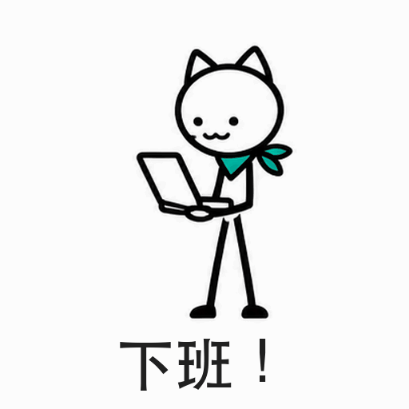 |

这组是纯文字生成的原创角色，分别是沙雕手绘、黏土、扁平贴纸、复古漫画、像素和火柴人风格。

## 里面有什么

| 内容 | 数量 | 说明 |
| --- | ---: | --- |
| [动作卡](CATALOG.md) | 430 | 每张都有三拍分镜、回环、笑点机制、强度、适用关系、动法和自然实拍标记 |
| 场景类目 | 38 | 回消息、工作进度、陪伴、小情绪、打工、发疯、干饭、节日、游戏、宠物、文字动效、写实整活等 |
| [风格](CATALOG.md#风格库) | 见图鉴 | 从沙雕手绘、像素、黏土到照片抠图、丑萌和混搭 |
| [动作模板](CATALOG.md#动作模板) | 见图鉴 | 复用姿势与节奏骨架，替换角色、道具、语气和画风 |
| [成套表情包](CATALOG.md#成套表情包) | 16 | 回消息、打工人、发疯、陪伴等候选动作集合，按本次要求选数量 |
| [热梗层](CATALOG.md#trends) | 28 | 说法与动作的对应表，标注收录日期，方便更新 |
| 工具 | 6 | 动作检索与导演说明、帧表合成与轻动、成片检查、中文叠字、拆帧、编码 |

## 需求怎样展开

新创作可以用三种方式组织，也可以组合：

| 组织方式 | 例子 |
| --- | --- |
| 同一句话，九种演法 | “我没事”分别演成强撑、融化、装镇定等反应 |
| 同一主体，九种反应 | 同一只戴围巾的猫演欢迎、拒绝、吃瓜、崩溃等态度 |
| 同一场景，九种用途 | 开会场景里做收到、催进度、甩锅、散会等回复 |

| 你给的素材 | 怎样使用 |
| --- | --- |
| 只有一句话，没指定主体 | 可以用不同人物、宠物或物件来演 |
| 文字指定了主体 | 保留描述中的特征；明确要求统一角色时，整组使用同一角色 |
| 一张图片 | 保留主体辨识特征，画风不自动限定为写实 |
| 图片加文字 | 图片确定主体，文字确定聊天意图和具体限制 |
| 多张图片 | 角色及关系清楚就按需使用；影响结果的关系不清楚时，只问关键歧义 |
| 已有成品 | 改字、调速等只修改目标文件，本地处理优先；有干净源帧时换字幕无需重新生成。“再来一组”“做九个新动作”才按新创作处理 |

说“先讨论”或“确认后再做”，就先停在讨论；已经要求开始制作并让你“自由发挥”，就直接组合，不增加选项确认。讨论中的“自由发挥几个方案”仍然只提供方案。详细规则见[需求理解](skills/gagcha/references/requests.md)。

## 新创作会拿到什么

- **6 或 9 个不同玩法的独立 GIF**，由你开工前决定，或按你明确指定的数量。动作、态度、笑点和道具可以不同；主体与风格是否统一，按本次要求决定。
- **集中预览和独立文件**。九宫格展示的是 9 个已完成的 GIF；它不是 9 帧动画，也不是静态候选。预览可直接排列原 GIF，无须额外生成或渲染大动图。
- **一次抽卡的结果**。不先出锚点图，不等前三张确认，不自动重生成，也不为了视觉评分反复修补。只做一次自动编码与可播放检查；生成失败就列出缺失，其余款继续。你点名要改哪款后，再处理那一款。

## 怎样设计玩法

- **笑点是设计出来的。** 八种笑点机制（反差、升级、崩坏、冷面、反转、字面、尺度、真诚）告诉模型为什么好笑，比“搞笑一点”具体得多。见[笑点手册](skills/gagcha/references/comedy.md)。
- **强度可调。** 同一张卡分克制、夸张、抽象三档：“好累”可以是长出一口气，也可以是流成一滩。
- **懂得看场合。** 每张卡标注工作群可用、朋友同事或仅熟人，说清发给谁就能自动过滤。
- **真人参考也能放开演。** 锁定基本特征与轮廓，让人认得出是谁；可以跨画风、大头、笑哭、颜艺和夸张变形。每次生成都实际传入原图，不靠文字描述替代。只有明确说“写实”“保留照片质感”时才锁定媒介，写实角色也可以大胆表演。
- **汉字不靠模型猜。** 文案在出片后叠加，字字准确，也能卡在爆点那一拍出现。
- **模板负责动作骨架。** 同一模板可换角色、道具、节拍、强度和画风。一组作品不是固定的模板组合。

素材各有分工：动作卡给聊天语义，模板给姿势骨架，笑点手册把口语气质变成意外，风格库决定视觉，场景包提供一组可用的回复。按需求组合，不必逐库走一遍。

## 快速开始

本技能面向 Codex。下载后把技能链接到个人技能目录（macOS / Linux）：

```sh
git clone https://github.com/BTCUP99/gagcha.git
cd gagcha
python -m pip install -r skills/gagcha/requirements.txt
mkdir -p ~/.agents/skills
ln -s "$PWD/skills/gagcha" ~/.agents/skills/gagcha
```

然后在 Codex 里说：**“用 $gagcha，给我做一组同事路过时慌忙收起摸鱼道具的表情。”** 它会先问你做 6 款还是 9 款；想只做一张，就明确说“只做一张”。有参考图就一起发。

工具需要 Python 3.9+ 和 Pillow。以后在这个目录运行 `git pull --ff-only` 就能更新到最新版，新开的 Codex 会话会直接用上。不想用 Git，也可以从 [Releases](https://github.com/BTCUP99/gagcha/releases) 下载压缩包，解压到 `~/.agents/skills/`。

## 怎样出片

你只管说要什么，Codex 用它当前有的能力出片，不需要配置，也不需要第三方插件：

| 情况 | 出片方式 |
| --- | --- |
| 当前工具能直接出 GIF | 直接生成 |
| 不能直接出，或请求被拒绝 | 内置图像工具生成一张帧表，本地合成 GIF，可逐帧控制节奏 |

每款只生成一次。这不是精修工具，粗糙和意外也是笑点的一部分；不满意的款，直接告诉它改哪张。

## 也可以手动使用

在 `skills/gagcha` 目录下运行：

```sh
python scripts/action.py "画大饼" --brief --style doodle-meme --intensity absurd   # 导演说明
python scripts/action.py "下班" --brief --character "戴墨镜的橘猫"                # 纯文字指定主体
python scripts/action.py --list-templates                                         # 可复用动作模板
python scripts/action.py --template snap-freeze --character "戴红围巾的饭团"       # 展开骨架
python scripts/action.py --pack worker-16 --character "戴红围巾的饭团"             # 包内候选
python scripts/action.py "我没事" --brief --photo-ref --style doodle-meme           # 原图锁辨识，允许换风格
python scripts/action.py --gag collapse --audience safe --list                      # 按笑点和关系筛选
python scripts/action.py "改需求" --to boss --photo-ok                              # 可选自然实拍筛选
python scripts/build_gif.py sheet 帧表.png 成品.gif --grid 2x2 --key                # 少量关键姿势直接合成
python scripts/caption_gif.py 成品.gif "我真的会谢" 带字.gif --from-ms 600            # 叠字
python scripts/inspect_gif.py 带字.gif --json                                      # 用户要求排错时可选
```

`--photo-ok` 只是筛选按自然身体比例可演的动作，不是使用真人参考图的必选项。轻动、联系表和原图对比工具仍可手动使用，但不进入默认的逐款视觉返修流程。

## 动作依据

中文平台历史数据、设计案例、社交研究和原创动作用途不同，图鉴把它们分开标注。大部分动作是本项目的创作提案，不声称流行度。详见[中文平台调研](research/zh-social.md)和[选取方法](research/method.md)。

## 参与贡献

欢迎提交新动作、模板、风格、表情包和热梗，见[贡献指南](CONTRIBUTING.md)。可以直接[提一个新动作](https://github.com/BTCUP99/gagcha/issues/new?template=new_action.yml)，不需要写代码。

## 路线图

- [ ] 按实际工具能力验证一次生成的不同出片路径
- [ ] 用真实生成的 GIF 做样片墙，同时保留失败记录
- [ ] 根据用户会选、会发的结果扩充动作与模板
- [ ] 持续扩充词库，并定期用新词测量覆盖率

## 许可证

[MIT 许可证](LICENSE) 覆盖本项目的代码、原创动作文案与示例。使用参考图时，请确认你有权制作和分享。
